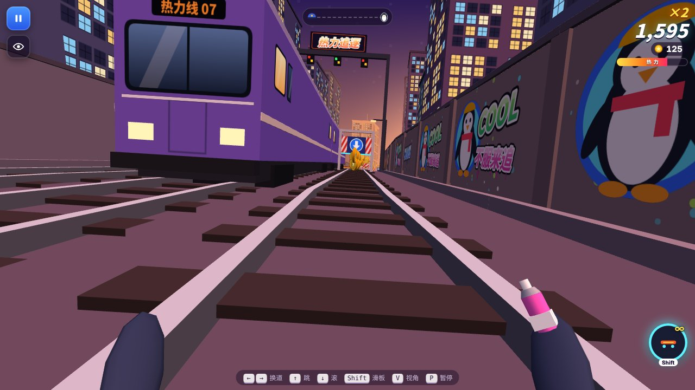
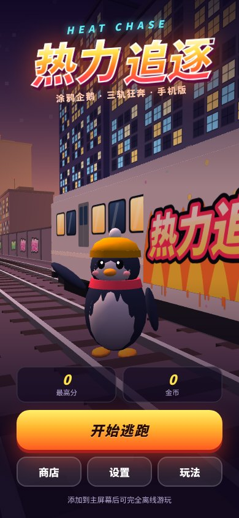
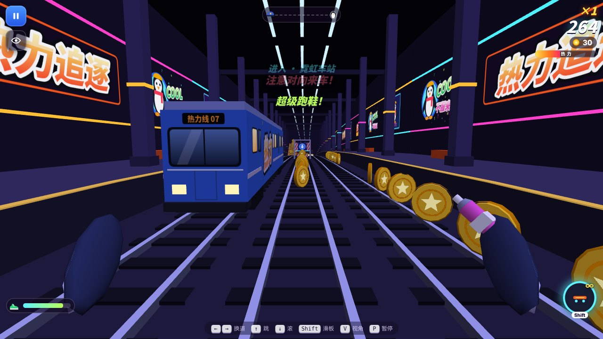
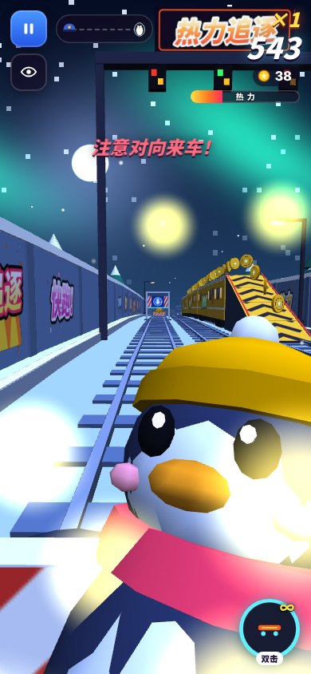
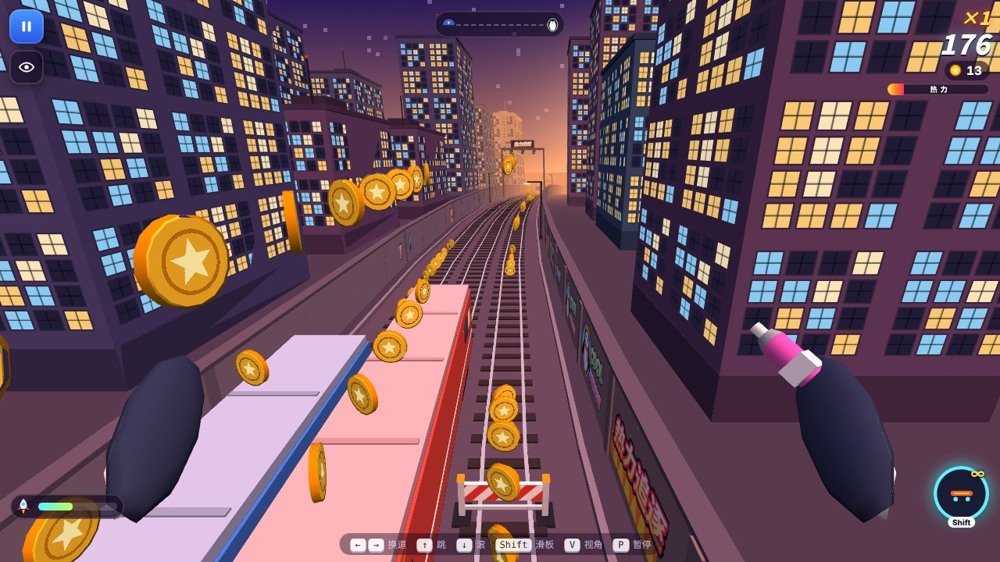
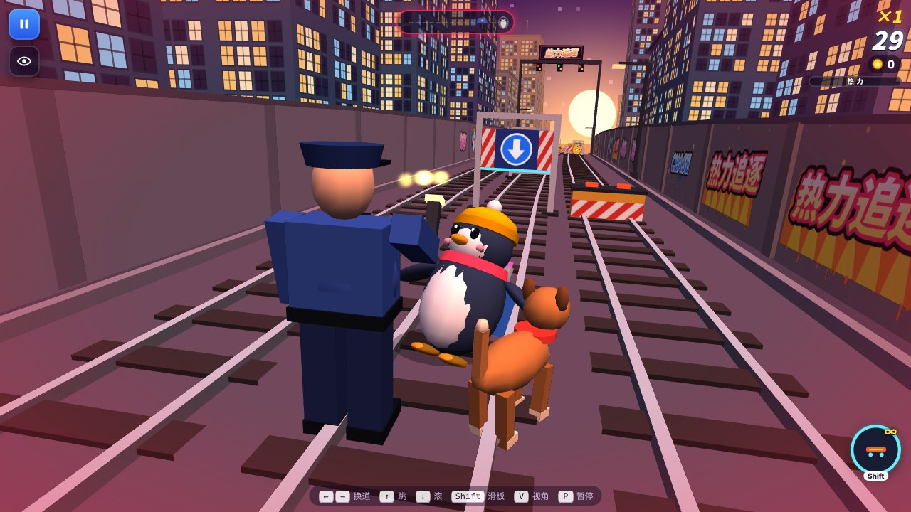

# 热力追逐 · HEAT CHASE

第一人称三轨道跑酷游戏。你是一只爱涂鸦的企鹅，在列车上喷漆时被警卫和小狗发现，只能沿着三条轨道一路狂奔——跑得越远分数越高，迎面撞上障碍本局结束。

**完全离线**：每个版本都是一个网页文件，不联网、不装任何东西就能玩；画面、贴图、音效、音乐全部由代码实时生成，没有外部资源。

| PC 版 | 手机版 |
| --- | --- |
|  |  |
|  |  |
|  |  |

## 怎么打开

| 版本 | 文件 | 打开方式 |
| --- | --- | --- |
| PC 版 | `pc/index.html` | 下载后直接双击，用 Chrome / Edge / Firefox / Safari 打开 |
| 手机版 | `mobile/index.html` | 把文件发到手机上用浏览器打开；或把仓库部署成网页（如 GitHub Pages）后用手机访问，再"添加到主屏幕"，之后断网也能玩 |
| 选择页 | `index.html` | 会根据设备推荐版本 |

进度（最高分、金币、升级、设置）保存在浏览器本地。

## 操作

| 动作 | PC 版 | 手机版 |
| --- | --- | --- |
| 切换车道 | `←` `→` 或 `A` `D` | 左右滑 |
| 跳跃 | `↑` / `W` / 空格 | 上滑 |
| 下蹲翻滚 | `↓` / `S` | 下滑 |
| 放出滑板（护盾） | `Shift` / `E` / 双击鼠标 | 双击屏幕，或点右下角滑板按钮 |
| 切换视角 | `V` | 左上角眼睛按钮 |
| 暂停 | `P` / `Esc` | 左上角暂停按钮 |

PC 版也支持按住鼠标拖动来"滑动"；空中再按一次下（或下滑）可以急速落地并接翻滚。

## 道具

| 道具 | 效果 |
| --- | --- |
| 喷气背包 | 短暂飞行，无视地面障碍，空中有一路金币 |
| 超级跑鞋 | 跳得更高，可以直接跳上车顶 |
| 磁铁 | 自动吸附附近金币 |
| 双倍得分 | 分数倍率翻倍 |
| 宝箱 | 随机奖励：金币、分数、热力，或一件道具 |
| 滑板 | 无限次使用的护盾：撞一下不会结束。每次持续 15 秒，用完或撞碎后充能 4 秒 |

## 玩法细节

- **热力倍率**：吃金币、贴身闪避会积攒热力，热力条满了倍率升一级，最高 ×10。
- **踉跄与追逐**：侧面蹭到列车只会踉跄，但警卫会追到身后（屏幕泛红、手电筒照到脚下）；这时再失误一次就会被抓。
- **车顶路线**：黄色斜坡能冲上车顶，车顶通常有一整排金币。
- **对向列车**：听到鸣笛、看到车灯时，旁边一定留有可以躲的轨道。
- **三个场景**循环出现：黄昏车场 → 霓虹车站 → 冰雪港口，速度逐渐加快。
- **视角**：默认第一人称（能看到企鹅的鳍和喷漆罐），可随时切到追尾视角看到整只企鹅。
- **商店**：用金币延长各道具时间，或给企鹅换围巾和帽子配色。
- 第一次玩会有一小段教学：跳、滚、换道各练一次。

## 目录结构

```
index.html            版本选择页
pc/index.html         PC 版（单文件，可直接打开）
mobile/index.html     手机版（单文件，可直接打开）
mobile/sw.js          手机版离线缓存
mobile/manifest.webmanifest
src/                  源码
  engine.js           数学、WebGL 渲染器、网格构建、粒子
  models.js           贴图图集与全部模型（企鹅、警卫、小狗、列车、场景……）
  world.js            关卡生成（保证始终有可通过的路线）
  game.js             主逻辑：物理、碰撞、道具、镜头、渲染、输入
  audio.js            音效与背景音乐（Web Audio 合成）
  ui.js / style.css   界面
  platform-pc.js      PC 版配置
  platform-mobile.js  手机版配置
build.js              把 src/ 合并成上面两个单文件
tools/test-world.js   关卡公平性检查
```

## 修改与构建

需要 Node.js（仅构建时用，游戏本身不需要）：

```bash
node build.js              # 重新生成 pc/index.html 和 mobile/index.html
node tools/test-world.js   # 检查生成的关卡不会出现必死局面
```

改了手机版之后，把 `mobile/sw.js` 里的 `VERSION` 改一下，已安装的手机才会拿到新版本。

## 说明

游戏内的角色、场景、涂鸦、图标、音效和音乐均为本项目原创并由代码生成。
